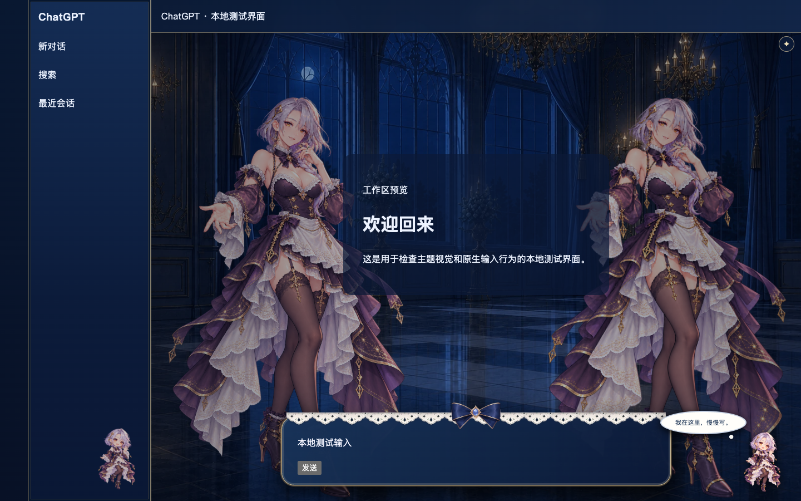

# Luma Codex · 星夜伴侣主题

在新版 ChatGPT 桌面客户端的新窗口中加载深色宫殿、原创角色、启动动画和 Q 版互动。它使用本地资源和独立启动器，不调用 Luma 旧启动器，也不修改官方客户端文件。

> **Windows 状态：实验性，尚未经过 Windows 实机验收。** 已实现查找官方安装包和启动入口，但不能保证每个 Windows / MSIX 版本可注入或正常发送消息。请先在 Windows 上检查启动、主题、发送、流式回复和退出后，再对外承诺 Windows 可用。Mac 版已在本机真实客户端的 Codex 视图完成主题加载检查；Chat / Work 视图、消息发送和流式回复仍需单独验收。



上图是本地模拟界面，不是官方客户端的截图。

## 要求

- 新版官方 ChatGPT 桌面应用（包含 ChatGPT / Work / Codex 的版本）；旧版 ChatGPT Classic 未适配。[官方客户端](https://chatgpt.com/download/)
- Git（用于拉取仓库）和 Node.js 18 或更高版本。macOS 优先使用官方客户端自带的 Node；Windows 优先使用 PATH 中已安装的 Node，再尝试客户端自带运行时。不会自动下载或安装依赖。
- Windows 的应用需要注册为官方 `OpenAI.Codex` 包。启动器通过 `Get-AppxPackage` 查询安装目录；找不到时可设置 `MAID_CHATGPT_EXE` 为该新版客户端的 `ChatGPT.exe` 绝对路径。

## 从 GitHub 运行

macOS：

```sh
git clone https://github.com/tetiplaybill-gif/luma-codex.git
cd luma-codex
./start-macos.command
```

Windows PowerShell：

```powershell
git clone https://github.com/tetiplaybill-gif/luma-codex.git
Set-Location luma-codex
.\start-windows.cmd
```

保持启动窗口打开；关闭启动进程或主题客户端即可退出。首次启动可能需要几十秒。开场可按 Esc 或点击“跳过开场”；界面右上角的 ✦ 可重播。点击右下角角色可以切换问候并播放轻柔提示音，声音不会自动播放。

如果希望让 Codex 协助启动，可以提供这个仓库地址并说“读取仓库说明并启动主题”；仓库也包含 `skills/luma-desktop-theme/SKILL.md` 和 Codex 插件清单。加载 skill 后再请求启动即可。仅发送 GitHub 地址本身不会自动执行代码。

## 验证与诊断

代码自检不需要安装第三方 npm 包：

```sh
node --test tests/platform.test.cjs tests/bundle.test.cjs tests/ipc.test.cjs tests/chromium-pipe.test.cjs
```

最后一项仅在找到本机 Chrome 或 Edge 时测试 Chromium 调试管道；若无浏览器会标记跳过。它不是对官方 ChatGPT Windows 客户端的验收。

macOS 在项目目录运行 `./start-macos.command --verify`；Windows 可运行 `./start-windows.cmd -Verify`。诊断会启动一个独立实例，检查主题、轮廓、侧栏、主区域、输入框和壁纸，然后关闭自己启动的实例；它不发送消息或读取聊天内容。Windows 仍需要真人验证实际对话和响应。

Windows 桌面客户端采用 MSIX 包；直接启动包内程序及其私有调试管道可能受到包身份、系统权限或客户端版本影响。出现无法加载、无法正常发送或自动退出时，请停止使用该实验版本，保留官方客户端，并提供不含会话内容的错误描述。不要复制其他人的账户、浏览器资料或凭据。

## 隐私与限制

- 启动器只向自己启动的客户端注入本地 UI，不拦截模型请求或读取聊天文本。调试管道由子进程继承，不开放调试 TCP 端口。
- 自定义 Chromium 配置目录**不保证账户和后端会话隔离**；新窗口可能仍显示已有内容。不要将用户配置目录加入 Git。
- 宿主更新可能改变选择器、启动参数或允许的调试方式；需要在新版本实测。目前选择器主要适配 Codex 视图；Chat / Work 视图可能无法完整换肤。窗口内角色交互不是对真实“思考 / 输出”状态的可靠识别。
- 开场角色为原创静态插画加描线、光流和淡入；不包含参考视频中完整的眨眼、口型和逐帧动作。

## 许可与署名

本项目软件部分采用 [MIT](LICENSE)。宫殿、蕾丝和蝴蝶结素材来自 [Small-tailqwq/dsh-deep-whale](https://github.com/Small-tailqwq/dsh-deep-whale) 的 `maid-atelier`，使用 **CC BY-NC-SA 4.0**：必须保留署名、仅限非商业使用，衍生素材需按相同方式共享。原作者链和完整许可见 [`licenses/NOTICE`](licenses/NOTICE) 与 [`licenses/LICENSE-ARTWORK`](licenses/LICENSE-ARTWORK)。本项目角色图为独立生成，不使用原仓库的鲸鱼娘角色。

**公开仓库不等于商业授权：**如果准备向付费客户销售或用于其他商业目的，应先更换这些非商业素材或取得权利人授权。
